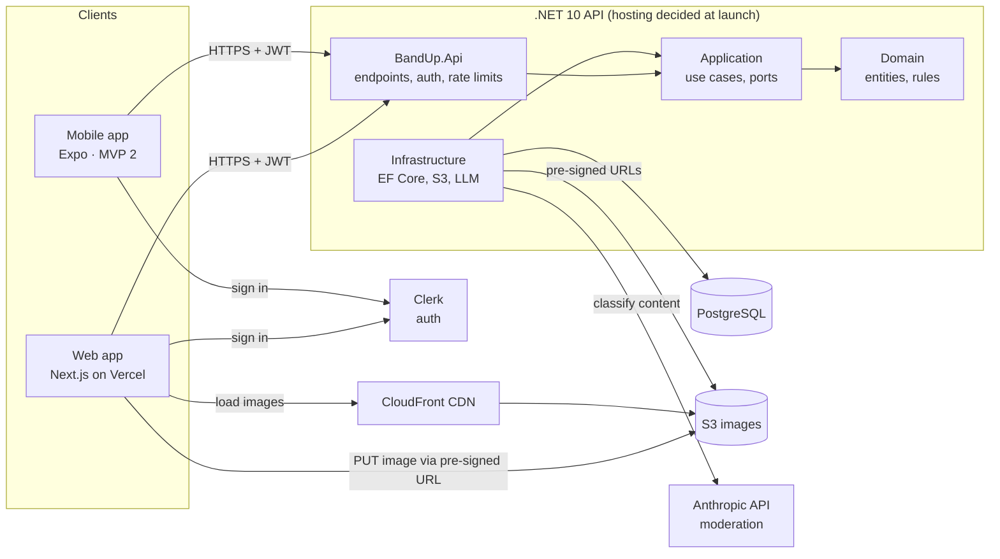

# BandUp architecture

## Overview

## Components

| Component | Responsibility | Decision |
| --- | --- | --- |
| Web (`apps/web`) | Mobile-first UI; server and client components; calls the API with the user's Clerk token | Next.js, Tailwind, shadcn/ui; Vercel (ADR 0003) |
| API (`apps/api`) | The single source of truth for data and rules; used by web and mobile | .NET 10, minimal APIs, clean layering |
| Auth | Sign-up and sign-in, sessions, social login; API validates JWTs via JWKS | Clerk (ADR 0001) |
| Database | Relational data; town centroids for distance search | PostgreSQL 18, EF Core migrations (ADR 0008) |
| Images | Private S3 bucket; uploads via short-lived pre-signed URLs; served via CloudFront | Images epic |
| Moderation | Classifies posts, comments and adverts for music relevance before publishing | Anthropic Haiku behind `IModerationService` (ADR 0005) |
| API client | TypeScript client generated from OpenAPI, shared by web and mobile | `packages/api-client` |
| Infrastructure | AWS resources as code | Terraform (ADR 0004), at launch (ADR 0002) |

## API layering

Dependencies point inwards, so business rules don't depend on frameworks:

- **Domain:** entities and invariants (e.g. "a band always has at least one admin"). No dependencies.
- **Application:** use cases and interfaces (ports) such as `IModerationService`, `IImageStorage` and `IFeedRanker`.
- **Infrastructure:** implementations of those ports (EF Core, S3, Anthropic, Clerk).
- **Api:** HTTP endpoints, authentication, authorisation policies, validation, rate limiting and composition.

## Key flows

**Posting with moderation**

1. The client sends `POST /posts`. The API validates the request, checks permission to post as a band if relevant, and applies rate limits.
2. The post is saved with status `Pending` and the API returns `202 Accepted`. The author sees "Checking…".
3. A background worker calls `IModerationService`, which returns `Approved`, `Rejected` (with a reason) or `NeedsReview`.
4. Approved posts appear in feeds. Rejected posts show the reason to the author. `NeedsReview` posts go to the admin queue.

**Image upload**

1. The client asks the API for an upload URL. The API checks type and size, then returns a pre-signed PUT URL for a single key, valid for a few minutes.
2. The client uploads directly to S3, then confirms with the API.
3. A processing step strips EXIF/GPS data and creates WebP sizes, served through CloudFront.

**Distance search**

Town centroids are stored as indexed latitude/longitude. The query filters by a bounding box (index-friendly), then sorts by Haversine distance. No PostGIS is needed (ADR 0008).

## Security model

| Control | How |
| --- | --- |
| Authentication | Clerk JWT validated by the API (issuer, audience, signature, expiry) |
| Authorisation | Authenticated by default; resource-based policies (`BandAdmin`, `ThreadParticipant`, `SiteAdmin`) checked on the server |
| Input | Validation on every request; RFC 7807 problem details; output escaped |
| Abuse | Rate limits on posting, messaging, reports and band creation; blocking; reports |
| Data | Town-level location only; secrets in user-secrets locally and a secrets manager in the cloud; private S3 bucket |
| Supply chain | NuGet audit fails the build; Dependabot; CodeQL; secret scanning |
| Web | Security headers now; nonce-based CSP in BAND-33 |

## Environments

| Environment | Web | API and database |
| --- | --- | --- |
| Local | `pnpm dev` (localhost:3000) | `dotnet run` (localhost:5080) + native Postgres 18 |
| CI | Build and test on GitHub Actions | Postgres 18 service container |
| Staging and production | Vercel | Decided at launch (ADR 0002), via Terraform |
