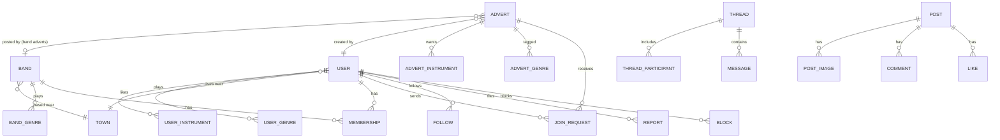

# BandUp data model (MVP 1 draft)

This refines the draft entity list from the kickoff. Changes from that list are marked **(refined)**.

## Diagram

## Conventions

- **IDs:** UUIDv7 primary keys. They're time-ordered, so indexes stay efficient, and safe to expose in URLs.
- **Timestamps:** `created_at` and `updated_at` as `timestamptz`, in UTC.
- **Soft delete:** `deleted_at` on posts, comments and adverts. Users are hard-deleted or anonymised on account deletion.
- **Moderation:** `moderation_status` (`Pending`, `Approved`, `Rejected`, `NeedsReview`) on posts, comments and adverts. Only `Approved` rows are publicly visible.
- **Polymorphic links (refined):** rather than `postedAsType` + `postedAsId`, use two nullable foreign keys (`posted_as_user_id`, `posted_as_band_id`) with a check constraint that exactly one is set. Real foreign keys keep referential integrity and make joins simple. The same applies to Follow and Report targets.

## Entities

| Entity | Key fields | Notes |
| --- | --- | --- |
| **User** | id, clerk_user_id (unique), display_name, bio, town_id, level, commitment, photo_key, is_site_admin | `level`: Beginner/Intermediate/Advanced/Professional. `commitment`: Casual/Regular/Serious |
| UserInstrument | user_id, instrument_id, is_primary | Composite primary key |
| UserGenre | user_id, genre_id | Composite primary key |
| **Band** | id, name, slug (unique), bio, town_id, photo_key | |
| BandGenre | band_id, genre_id | |
| **Membership** | id, band_id, user_id, role (Admin/Member), status (Current/Former), joined_at, left_at | Partial unique index: one Current membership per user per band. Rule: a band always has at least one Current Admin |
| **Advert** | id, type (BandSeekingMember/MusicianSeekingBand), created_by_user_id, band_id (band adverts only), title, description, town_id, level, commitment, status (Open/Closed), expires_at, moderation_status | Check constraint: band_id is set if and only if type is BandSeekingMember |
| AdvertInstrument, AdvertGenre | advert_id, instrument_id / genre_id | |
| **JoinRequest** | id, advert_id, band_id, user_id, message, status (Pending/Accepted/Declined/Withdrawn), decided_by_user_id, decided_at | Partial unique index: one Pending request per user per advert |
| **Thread** | id, join_request_id (nullable), advert_id (nullable), created_at | **(refined)** Context is one of the two |
| ThreadParticipant | thread_id, user_id, last_read_at | **(refined)** Drives unread counts and permission checks |
| **Message** | id, thread_id, sender_user_id, body, created_at | |
| **Post** | id, author_user_id, posted_as_user_id, posted_as_band_id, body, link_url, link_kind (YouTube/SoundCloud), moderation_status, deleted_at | Feed index on (moderation_status, created_at desc) |
| PostImage | id, post_id, storage_key, width, height, alt_text, position | **(refined)** Up to 4 per post |
| **Comment** | id, post_id, author_user_id, body, moderation_status, deleted_at | Flat, no nesting in MVP 1 |
| **Like** | post_id, user_id, created_at | Composite primary key, so one like per user per post |
| **Follow** | follower_user_id, followed_user_id, followed_band_id, created_at | Exactly one target; unique per follower and target |
| **Report** | id, reporter_user_id, target (post/comment/advert/user via nullable FKs), reason, note, status, resolved_by_user_id | One report per reporter per target |
| ModerationDecision | id, target (nullable FKs), result, reason, model, decided_at | **(refined)** Audit trail for LLM and admin decisions |
| Block | blocker_user_id, blocked_user_id | **(refined)** |
| **Town** | id, name, county_or_region, country, latitude, longitude | Reference data; index on (latitude, longitude) and name search |
| Instrument, Genre | id, name, slug | Seeded reference data |

## Indexes to support the 300ms target

- `advert (status, moderation_status, town lat/lng)`, via a join to `town`, for bounding-box distance search.
- `post (moderation_status, created_at desc)`, plus `post (posted_as_band_id)` and `post (posted_as_user_id)` for the Following feed.
- `follow (follower_user_id)`, `membership (user_id, status)`, `thread_participant (user_id)` and `message (thread_id, created_at)`.
